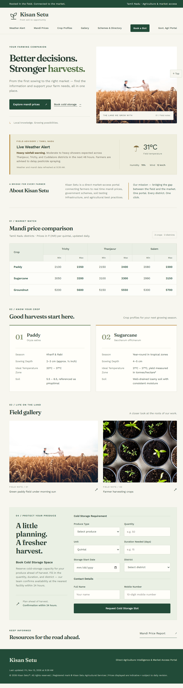
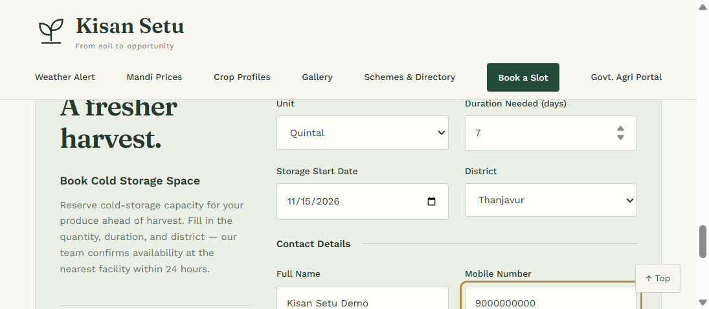
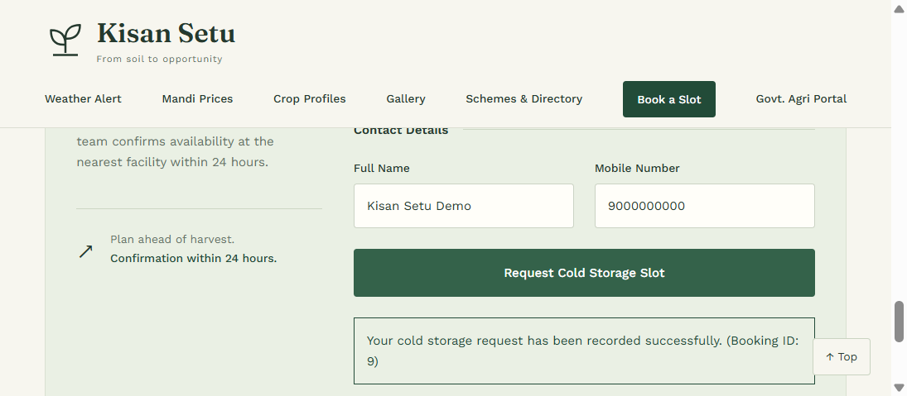
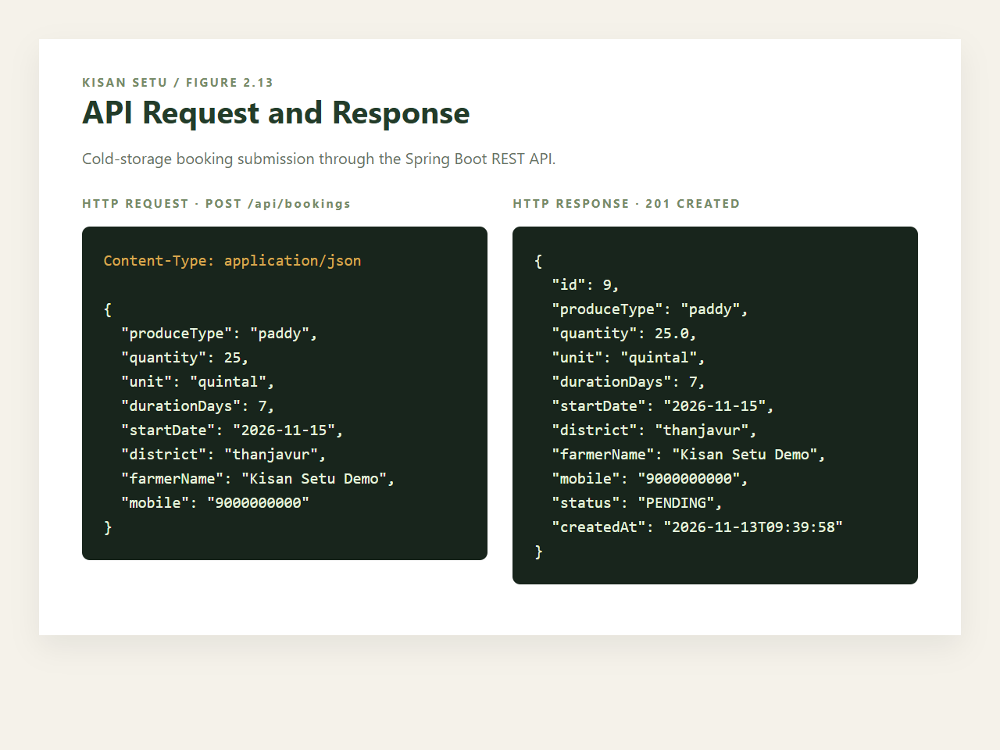
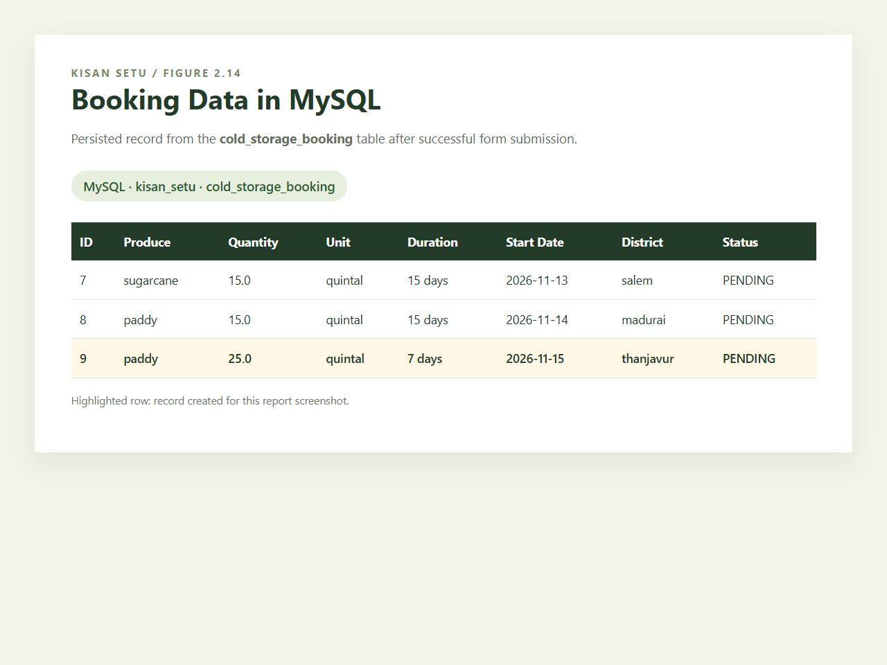

# Kisan Setu

### Direct Agriculture Intelligence & Market Access Portal

Kisan Setu is a full-stack web application that helps farmers access agriculture information and request cold-storage capacity through a single portal. The project combines a responsive React interface with a Spring Boot REST API and MySQL persistence.

## Project highlights

- Responsive agriculture-focused user interface built with React 18 and Vite
- Cold-storage booking workflow with client-side validation
- REST API built with Spring Boot 3.2.5 and Java 17
- MySQL persistence through Spring Data JPA and Hibernate
- Booking validation, status tracking, timestamps, and API error handling
- Mandi price comparison, crop profiles, weather advisory, field gallery, and resource links
- Vite development proxy connecting the frontend to the backend API

## Technology stack

| Layer | Technologies |
| --- | --- |
| Frontend | React 18, Vite, HTML5, CSS3 |
| Backend | Java 17, Spring Boot, Spring Web, Spring Data JPA |
| Database | MySQL, Hibernate ORM, MySQL Connector/J |
| Testing | JUnit, Spring Boot Test |
| Development | Maven, npm |

## Application flow

```text
Farmer browser
     │
     ▼
React + Vite frontend :5173
     │  POST /api/bookings
     ▼
Spring Boot REST API :8080
     │  Spring Data JPA / Hibernate
     ▼
MySQL database: kisan_setu
```

## Features

### Farmer dashboard

The home page brings together a weather advisory, mandi price comparison, crop profiles, field images, government agriculture links, and a cold-storage booking call-to-action.

### Cold-storage booking

Users can submit:

- Produce type
- Quantity and unit
- Storage duration
- Storage start date
- District
- Farmer name and mobile number

Successful requests receive a generated booking ID and are stored with a `PENDING` status.

## Screenshots

### Integrated Kisan Setu home page



### Cold-storage booking form



### Booking form submission



### API request and response



### Booking data persisted in MySQL



## Getting started

### Prerequisites

Install the following before running the project:

- Node.js 18 or later
- Java 17
- Maven 3.8 or later
- MySQL 8 or later

### 1. Clone the repository

```bash
git clone https://github.com/tosham-behera/Kisan-Setu.git
cd Kisan-Setu
```

### 2. Create the MySQL database

```sql
CREATE DATABASE kisan_setu;
```

The application uses Hibernate with `ddl-auto=update`, so the mapped tables are created or updated automatically when the backend starts.

### 3. Configure database credentials

The backend reads credentials from environment variables. PowerShell example:

```powershell
$env:DB_USERNAME = "root"
$env:DB_PASSWORD = "your-mysql-password"
```

Keep credentials local. Do not commit `.env` files or passwords to GitHub.

### 4. Start the backend

Open a terminal in the project root:

```bash
cd backend
mvn spring-boot:run
```

The API starts on `http://localhost:8080`.

### 5. Start the frontend

Open a second terminal in the project root:

```bash
npm install
npm run dev
```

Open `http://localhost:5173` in a browser. Vite forwards `/api` requests to the Spring Boot server on port `8080`.

## API reference

### Create a booking

```http
POST /api/bookings
Content-Type: application/json
```

Example request:

```json
{
  "produceType": "paddy",
  "quantity": 25,
  "unit": "quintal",
  "durationDays": 7,
  "startDate": "2026-11-15",
  "district": "thanjavur",
  "farmerName": "Kisan Setu Demo",
  "mobile": "9000000000"
}
```

### List bookings

```http
GET /api/bookings
```

### Get one booking

```http
GET /api/bookings/{id}
```

Successful booking creation returns `201 Created` with the saved booking, generated ID, status, and creation timestamp.

## Project structure

```text
Kisan-Setu/
├── backend/
│   ├── src/main/java/com/kisansetu/
│   │   ├── controller/       # REST endpoints
│   │   ├── entity/           # JPA entities
│   │   ├── exception/        # Validation and API errors
│   │   ├── repository/       # Spring Data repositories
│   │   └── service/          # Business logic
│   ├── src/test/             # Controller and service tests
│   └── pom.xml
├── docs/screenshots/         # README and report screenshots
├── src/
│   ├── App.jsx               # Main React application and booking flow
│   ├── main.jsx              # React entry point
│   └── styles.css            # Responsive frontend styles
├── package.json
├── vite.config.js
└── index.html
```

## Testing

Run the backend tests from the backend directory:

```bash
mvn test
```

Build the frontend:

```bash
npm run build
```

## Current scope

This project is a local development implementation. Weather readings, mandi prices, and crop profiles are currently represented by frontend data. Authentication, payments, notifications, admin workflows, and live external agriculture APIs are outside the current scope.

## Author

Built as a full-stack web development project demonstrating React frontend development, REST API design, backend validation, database persistence, and responsive UI implementation.
