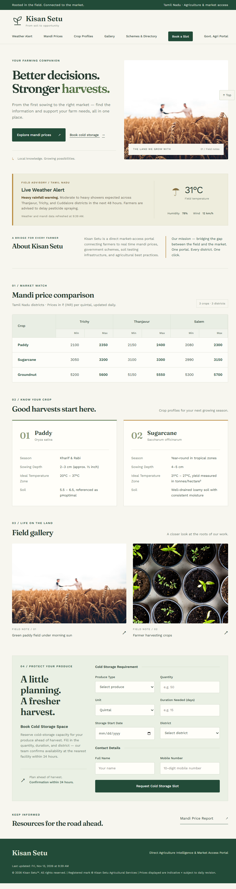
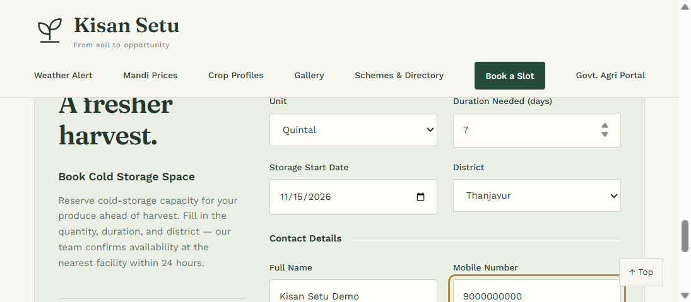
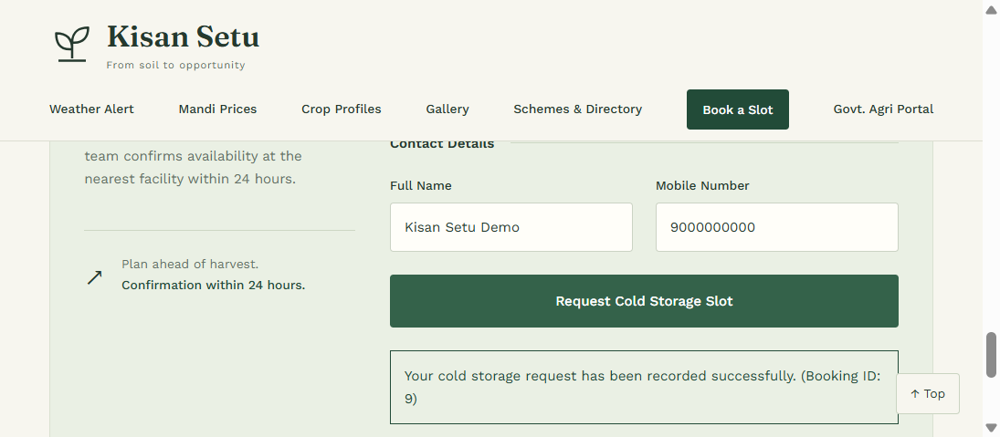
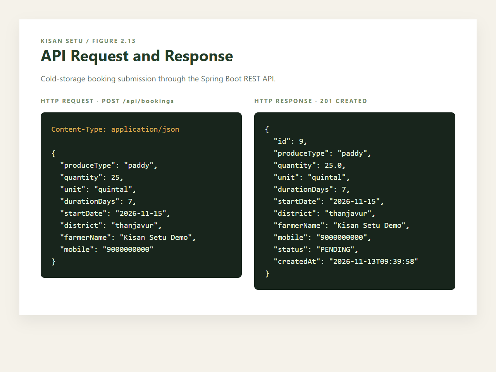
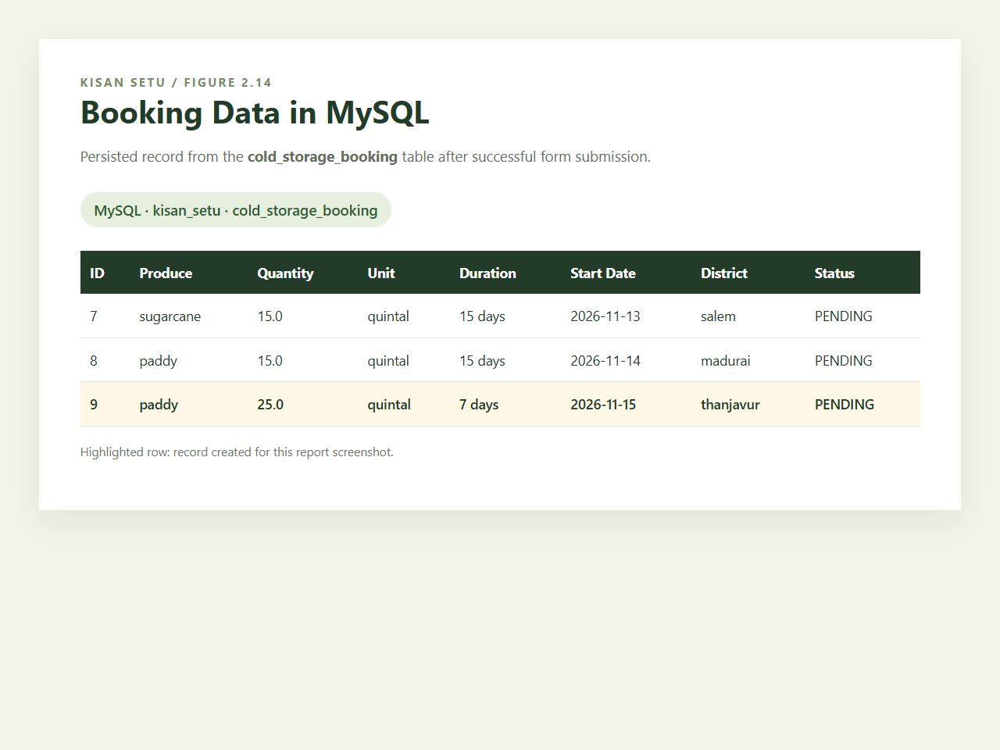

# Kisan Setu Report Screenshots

Use the following figures in the project report in this order.

**Figure 2.10: Integrated Kisan Setu Home Page**

**Figure 2.11: Cold-Storage Booking Form**

**Figure 2.12: Booking Form Submission**

**Figure 2.13: API Request and Response**

**Figure 2.14: Booking Data in MySQL**
